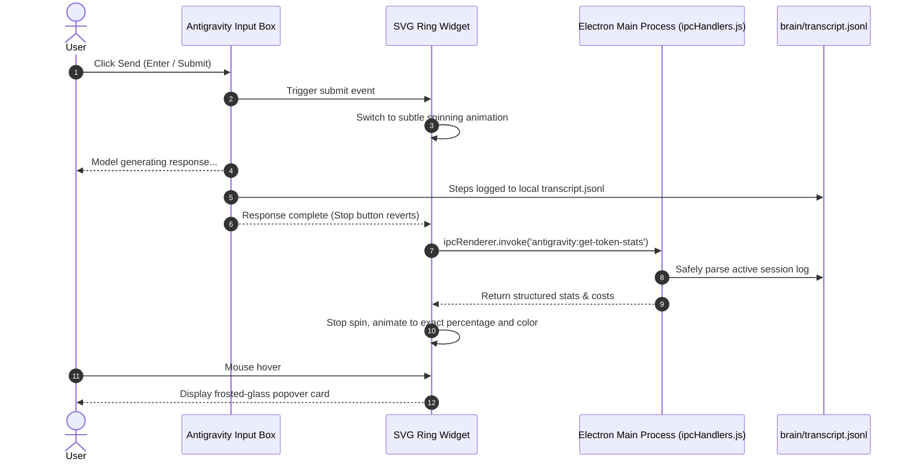

# Antigravity Token Ring ⚡

**Real-time Token Usage & Context Quota Monitor Ring for Google Antigravity 2.0+**

**English** · [中文说明](README.zh.md)

[](LICENSE)
[](#)
[](#)

Inspired by the DeepSeek Harness ecosystem plugin `dsh-usage-cost`, **Antigravity Token Ring** brings a non-intrusive, native circular progress ring right to the bottom-right corner of the chat input box (next to the send button) across all pages of **Google Antigravity 2.0**.

It monitors your current session's model context window utilization, Prompt Cache hit efficiency, and pops up a frosted-glass card on hover showing today's cumulative token consumption and multi-currency cost estimates (USD / CNY).

---

## ✨ Features

- 🎯 **Native Seamless Integration**: Positioned natively beside the chat send button across all chat tabs and pages without obscuring text or inputs.
- ⚡ **Context Window Monitoring**: Accurately measures the token occupancy of the active session context against the model limit (e.g., `42.5k / 1.0M`).
- 🎨 **Three-Tier Status Colors**:
  - 🟢 **< 60%**: Emerald Green (Ample headroom)
  - 🟡 **60% ~ 80%**: Amber Yellow (Context growing)
  - 🔴 **≥ 80%**: Rose Red (Approaching context exhaustion; recommend starting a new session or running `/compact`)
- 🚀 **Prompt Cache Hit Rate**: Highlights Prompt Cache efficiency and cost savings in real-time.
- 💰 **Dual-Currency Cost Estimation**: Real-time USD and CNY cost calculation weighted by input miss, cache hit, and output tokens.
- 🔄 **Two-Phase Lifecycle Feedback**: Subtly spins during model thinking/generation, and smoothly animates to the exact settled numbers upon completion.
- 🛡️ **Zero Runtime Overhead**: Built on Electron's standard dual-process IPC architecture (Main Process reads local session files + Preload injects DOM). No background daemons, no open ports, 100% offline.

---

## 📸 Preview

```
┌────────────────────────────────────────────────────────────────────────┐
│  Ask anything, @ to mention, / for actions...                          │
│                                                                        │
│                                           ┌─────────────────────────┐  │
│                                           │  ● Context Quota   4.2% │  │
│                                           │  Session:   42.5k / 1.0M│  │
│                                           │  Cache Hit:        92.4%│  │
│                                           │  Turns:          6 calls│  │
│                                           │  ────────────────────── │  │
│                                           │  Today's Total:   142.5k│  │
│                                           │  Session Cost: $0.02    │  │
│                                           └───────────┬─────────────┘  │
│  [📎 Attach]  [⚙️ Models]                          [ 🟢 ]  [ 🚀 Send ] │
└───────────────────────────────────────────────────────┴────────────────┘
                                                  ▲
                                      Hover to reveal details
```

---

## 🛠️ Architecture & Data Flow



---

## 🚀 Quick Start

### Prerequisites
- [Node.js](https://nodejs.org/) installed (`node` and `npx` available in PATH, v18+).
- **Google Antigravity 2.0+** installed.

### 1. Clone the repository
```bash
git clone https://github.com/your-username/antigravity-token-ring.git
cd antigravity-token-ring
```

### 2. Run the one-click installer
```bash
python install.py
```
> **Note**: The script auto-detects your operating system and locates `app.asar`. It **automatically creates an `app.asar.token_ring_backup` file** before modifying anything, making the process 100% reversible.

To specify a custom path manually:
```bash
python install.py --asar "/path/to/Antigravity/resources/app.asar"
```

### 3. Restart Antigravity
Fully exit and restart Antigravity 2.0 (`Ctrl+Q` / exit from the tray and reopen). You will see the circular monitor widget in the bottom-right corner of the input area!

---

## 🔄 Uninstallation

To restore Antigravity back to its original state, run:

```bash
python uninstall.py
```
or:
```bash
python install.py --uninstall
```

---

## ⚙️ Configuration

You can customize context ceilings and pricing in `src/ipc-handler.js` and `src/ring-widget.js`:

### Adaptive Context Limits
| Model Keyword | Context Window Ceiling (100% baseline) |
|---|---|
| `pro` (Gemini 2.5 Pro) | 2,097,152 Tokens (2M) |
| `flash` / `gemini` (Gemini 3.8 / 2.5 Flash) | 1,048,576 Tokens (1M) |
| `claude` / `sonnet` (Claude 3.5 / 3.7 Sonnet) | 200,000 Tokens (200k) |
| `deepseek` (DeepSeek V3 / R1) | 128,000 Tokens (128k) |
| Default Fallback | 1,048,576 Tokens (1M) |

### Pricing Reference
```javascript
// USD / 1M Tokens (benchmark)
const PRICING = {
    hit: 0.0375,   // Prompt Cache Read
    miss: 0.15,    // Cache Miss Input
    out: 0.60      // Output / Generation
};
const USD_TO_CNY = 7.23;
```

---

## 📁 Repository Structure

```text
antigravity-token-ring/
├── .gitignore               # Git ignore rules
├── LICENSE                  # MIT License
├── README.md                # English Documentation
├── README.zh.md             # Chinese Documentation
├── install.py               # Cross-platform installer
├── uninstall.py             # One-click restore script
└── src/
    ├── ipc-handler.js       # Main-process log parser & token aggregator
    └── ring-widget.js       # Renderer-layer SVG ring & frosted-glass UI
```

---

## ❓ FAQ

<details>
<summary><b>Q: I restarted Antigravity, but the ring isn't visible?</b></summary>

1. Ensure Antigravity was fully quit (sometimes it remains running in the background system tray).
2. Press `Ctrl+Shift+I` (or `F12`) to open Developer Tools and check the Console tab for any error messages or `[TokenRing]` initialization logs.
</details>

<details>
<summary><b>Q: What happens if Antigravity updates?</b></summary>

Major updates may overwrite `app.asar`. Simply re-run `python install.py` once after an update to re-apply the patch.
</details>

<details>
<summary><b>Q: Are my conversation contents or tokens uploaded anywhere?</b></summary>

No. The entire process runs 100% locally and offline. It only reads local logs stored in `~/.gemini/antigravity/brain`. No network telemetry is sent.
</details>

---

## 📄 License

This project is licensed under the [MIT License](LICENSE).
