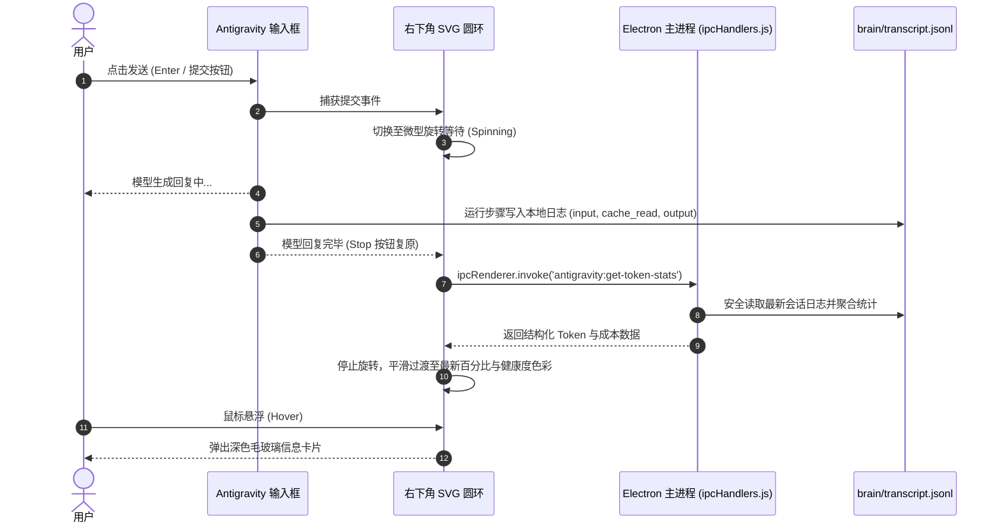

# Antigravity Token Ring ⚡

**实时 Token 消耗与上下文配额监控圆环（用于 Google Antigravity 2.0+）**

[English](README.md) · **中文说明**

[](LICENSE)
[](#)
[](#)

灵感源自 DeepSeek Harness 官方插件 `dsh-usage-cost`。本项目专为 **Google Antigravity 2.0** 打造，无侵入地在每一个聊天页面的输入框右下角（发送按钮旁）嵌入一个精致的**微型环形进度指示器**。

实时监控当前会话的上下文窗口占用比例、Prompt Cache 命中效率，并在悬浮时展示今日总消耗与多币种（USD / CNY）预估费用。

---

## ✨ 核心特性

- 🎯 **原生级 UI 深度整合**：无需打开多余网页，无缝锚定在 Antigravity 2.0 所有页面的聊天输入框操作条上，与原生发送按钮并排呈现，绝不遮挡文字与按钮。
- ⚡ **会话上下文动态监控**：精准计算当前会话占用的模型上下文容量（例如 `42.5k / 1.0M`），直观反馈距离上下文满额还有多远。
- 🎨 **三色健康度预警**：
  - 🟢 **< 60%**：绿色，上下文充裕；
  - 🟡 **60% ~ 80%**：黄色，上下文逐步增加；
  - 🔴 **≥ 80%**：红色警示，提醒用户及时开启新会话或使用 `/compact` 压缩上下文。
- 🚀 **Prompt Cache 命中率分析**：直观展示当前对话的 Prompt 缓存复用率，一眼掌握当前上下文的复用省钱程度。
- 💰 **双币种成本核算**：基于输入未命中、缓存命中、输出 Token 权重，实时换算美元（USD）与折合人民币（CNY）花费。
- 🔄 **智能两阶段反馈**：用户点击发送瞬间圆环进入微型呼吸旋转等待，模型回复完毕一次性精准结算最新 Tokens。
- 🛡️ **双进程 IPC 极简架构**：基于 Electron 标准双进程架构（主进程原生安全读盘 + 渲染层纯 DOM 注入），无需额外启动任何后台守护进程或开放网络端口。

---

## 📸 界面预览

```
┌────────────────────────────────────────────────────────────────────────┐
│  Ask anything, @ to mention, / for actions...                          │
│                                                                        │
│                                           ┌─────────────────────────┐  │
│                                           │  ● 上下文配额     4.2%  │  │
│                                           │  会话占用:  42.5k / 1.0M│  │
│                                           │  Prompt 命中率:  92.4%  │  │
│                                           │  对话轮次:         6 次 │  │
│                                           │  ────────────────────── │  │
│                                           │  今日总消耗:    142.5k  │  │
│                                           │  本会话花费: $0.02(¥0.14)│ │
│                                           └───────────┬─────────────┘  │
│  [📎 附件]  [⚙️ 模型选择]                         [ 🟢 ]  [ 🚀 发送 ] │
└───────────────────────────────────────────────────────┴────────────────┘
                                                  ▲
                                         悬浮弹出深色毛玻璃卡片
```

---

## 🛠️ 工作原理



---

## 🚀 快速安装

### 前提条件
- 已安装 [Node.js](https://nodejs.org/)（需包含 `node` 与 `npx` 命令，v18+ 均可）。
- 已安装 **Google Antigravity 2.0+**。

### 1. 克隆本仓库
```bash
git clone https://github.com/your-username/antigravity-token-ring.git
cd antigravity-token-ring
```

### 2. 执行一键安装
```bash
python install.py
```
> **提示**：安装脚本会自动检测操作系统并寻找 `app.asar` 路径。在注入前会**自动创建 `.token_ring_backup` 备份**，确保 100% 安全可逆。

如果您的客户端安装在非默认路径，可通过 `--asar` 参数手动指定：
```bash
python install.py --asar "D:\Path\To\Antigravity\resources\app.asar"
```

### 3. 重启 Antigravity
安装成功后，请**完全退出并重启一次 Antigravity 2.0**（托盘右键退出或 `Ctrl+Q` 后重新打开）。现在打开任意项目对话，即可在输入框右下角看到动态圆环！

---

## 🔄 卸载与还原

若需要完全还原为原始状态，随时运行以下命令即可无损恢复：

```bash
python uninstall.py
```
或者：
```bash
python install.py --uninstall
```

---

## ⚙️ 模型配额与计费配置

在 `src/ipc-handler.js` 与 `src/ring-widget.js` 中内置了常用模型的上下文配额与计费单价，您可根据使用情况随时自由调整：

### 模型上下文上限自动识别
| 模型关键词 | 预设上下文上限 (100% 满额基准) |
|---|---|
| `pro` (Gemini 2.5 Pro 等) | 2,097,152 Tokens (2M) |
| `flash` / `gemini` (Gemini 3.8 / 2.5 Flash) | 1,048,576 Tokens (1M) |
| `claude` / `sonnet` (Claude 3.5 / 3.7 Sonnet) | 200,000 Tokens (200k) |
| `deepseek` (DeepSeek V3 / R1) | 128,000 Tokens (128k) |
| 默认缺省 | 1,048,576 Tokens (1M) |

### 计费口径与单价
```javascript
// USD / 1M Tokens (基准参考)
const PRICING = {
    hit: 0.0375,   // Prompt Cache 命中输入单价
    miss: 0.15,    // 缓存未命中基础输入单价
    out: 0.60      // 模型生成输出单价
};
const USD_TO_CNY = 7.23; // 汇率
```

---

## 📁 目录结构

```text
antigravity-token-ring/
├── .gitignore               # Git 忽略配置
├── LICENSE                  # MIT 开源协议
├── README.md                # 英文说明文档
├── README.zh.md             # 中文说明文档
├── install.py               # 一键跨平台注入与打包脚本
├── uninstall.py             # 一键备份还原与卸载脚本
└── src/
    ├── ipc-handler.js       # 主进程安全读盘与 Token 聚合计算服务
    └── ring-widget.js       # 渲染层 SVG 圆环、动效与毛玻璃 Tooltip
```

---

## ❓ 常见问题 (FAQ)

<details>
<summary><b>Q: 重启后输入框右下角没有出现圆环？</b></summary>

1. 请确认是否完全退出了 Antigravity（部分情况下它仍在系统托盘后台运行，请在托盘右键彻底退出后重开）。
2. 在 Antigravity 界面按下 `Ctrl+Shift+I`（或 `F12`）打开开发者工具，检查 Console 控制台是否有报错信息，或是否显示 `[TokenRing]` 加载日志。
</details>

<details>
<summary><b>Q: 客户端后续更新了，圆环还会存在吗？</b></summary>

当 Antigravity 官方进行大版本覆盖更新时，官方安装包会重写 `app.asar`。更新后只需重新在本项目目录运行一次 `python install.py` 即可重新激活。
</details>

<details>
<summary><b>Q: 数据统计有隐私风险吗？</b></summary>

完全没有。本插件为 100% 本地纯离线运行，所有计算均在您的本机读取 `~/.gemini/antigravity/brain` 本地日志，不发送任何外部网络请求，代码完全开源透明。
</details>

---

## 📄 开源许可证

本项目基于 [MIT License](LICENSE) 开源。欢迎提 Issue 与 PR！
